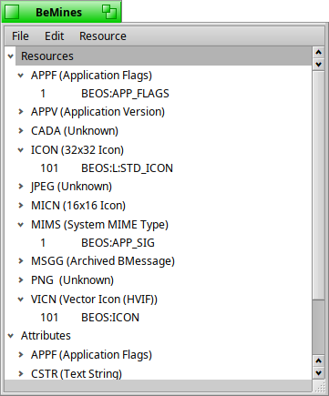
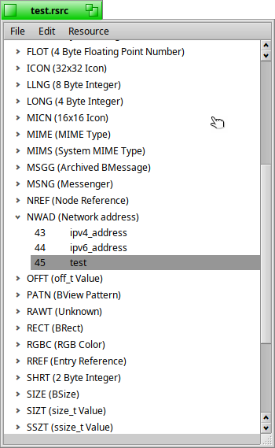
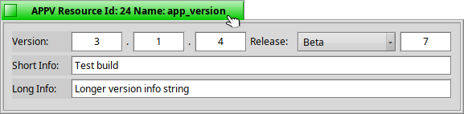

# Resourcer

Resourcer is an open-source resource editor for the BeOS. It contains editors for 61 data types, including windows (for building app interfaces), cursors, images, sounds, movies, icons, and text. It is distributed under the BSD license. You get the source and the latest stable binaries from the downloads page. Please help out if can; Resourcer can not improve without your help.
### News:

Resourcer released under the BSD license.

## Building

On Haiku, with the development tools installed, run `make` in the top level
folder. The result is in the `build` folder: the `Resourcer` application and
an `editors` folder with one add-on per resource type. Resourcer finds its
editors in the `editors` folder next to the application, so you can run
`build/Resourcer` right where it is.

* `make editor-TEXT` builds a single editor
* `make app`, `make editors` and `make reslib` build just that part
* `make test` compiles the sample resource file, see Testing below
* `make clean` removes everything that was built

The code is kept compatible with gcc2 (`x86_gcc2` hybrid builds of Haiku).

## Testing

`make test` compiles `tests/test.rdef` into `build/test.rsrc`. The file holds
one resource of every type Resourcer has an editor for, except the image
formats and the window and movie types (try those by dropping image files, and
with your own resources). Open it in Resourcer and double-click a resource to
try its editor.

## Supported types

Double-click a resource to open its editor. The editors are add-ons in the
`editors` folder, one per type code, and the Add Resource menu lists whatever
is there. A type without an editor opens in a generic editor with a hex dump
and an ASCII view of the data.

| Kind | Types |
|---|---|
| Whole numbers | `BYTE` `UBYT` `SHRT` `USHT` `LONG` `ULNG` `LLNG` `ULLG` `SIZT` `SSZT` `OFFT` `TIME` |
| Other values | `BOOL` `CHAR` `FLOT` `DBLE` |
| Text | `CSTR` text string, `TEXT` ASCII text, `MIME` and `MIMS` MIME types, `STRL` string list (one string per line) |
| Geometry and color | `BPNT` point, `RECT` rectangle, `SIZE`, `ALGN` alignment, `AMTX` affine transform, `PATN` pattern, `RGBC` color |
| References | `RREF` entry reference, `NREF` node reference, `MSNG` messenger |
| Applications | `APPF` application flags, `APPV` application version |
| Messages and catalogs | `MSGG` archived BMessage, `CADA` locale catalog (read only) |
| Icons and bitmaps | `ICON` 32x32 and `MICN` 16x16 icons, `VICN` vector icon (HVIF), `CURS` cursor, `bits` bitmap, `BBMP` archived bitmap (read only) |
| Interface and media | `WIND` window layout, `MOOV` movie, `nois` sound |
| Images | `GIF` `JPEG` `PNG` `PPM` `TGA` `BMP` `TIFF` `WebP` `PSD` `AVIF` `ICNS` `ICO` `PCX` `JP2` `SGI` `WBI` `RAWI` |

`SIZT`, `SSZT` and `OFFT` are edited as 4 byte values. On 64 bit Haiku the real
types are 8 bytes wide, so a value stored that way isn't shown in full. The
Resource menu's Open with Generic Editor shows all of the bytes.

### Images

The image editors cover the formats Haiku has translators for. Each shows the
picture with its size, and a Replace... button or a dropped image file puts a
new one in. An image in another format is converted to the editor's format
first, which needs the translator for that format to be installed.

Dropping an image file on the resource list adds a `bits` bitmap. Dropping it
on the heading of an image type, such as `PNG`, or on one of that type's
resources adds it as that type instead, converting it if needed.

## Dropping files

Files dropped on the resource list are added to the open file:

* an image becomes a resource, as described above
* a file with vector icons, usually an application, adds them as `VICN` resources
* a resource file (type `application/x-be-resource`, such as an `.rsrc`) is merged into the open one
* an `.rdef` file asks whether to open it as a new file or merge it

## RDEF import and export

File > Export as RDEF... writes every resource in the file as an rdef script,
the text format Haiku's `rc` compiles. Resource > Export Resource as RDEF...
does the same for the highlighted resource, and Edit > Copy as RDEF puts it on
the clipboard. Attributes can't be written in rdef, so they are left out.

The writing code (`main/rdefexport.cpp`) is Haiku's rsrc-to-rdef decompiler
from `src/bin/rc/decompile.cpp`, Copyright (c) 2003 Matthijs Hollemans, MIT
license, cut down to work on resources that are already open.

Dropping an `.rdef` file on the resource list compiles it with `rc` and asks
whether to open the result as a new file or merge it into the open one. A
resource with the same type and ID as an existing one is replaced. Opening an
`.rdef` file from File > Open, Tracker or Open With compiles it and opens the
result as a new file. `rc` must be in the path, as it is on a standard Haiku
install.
